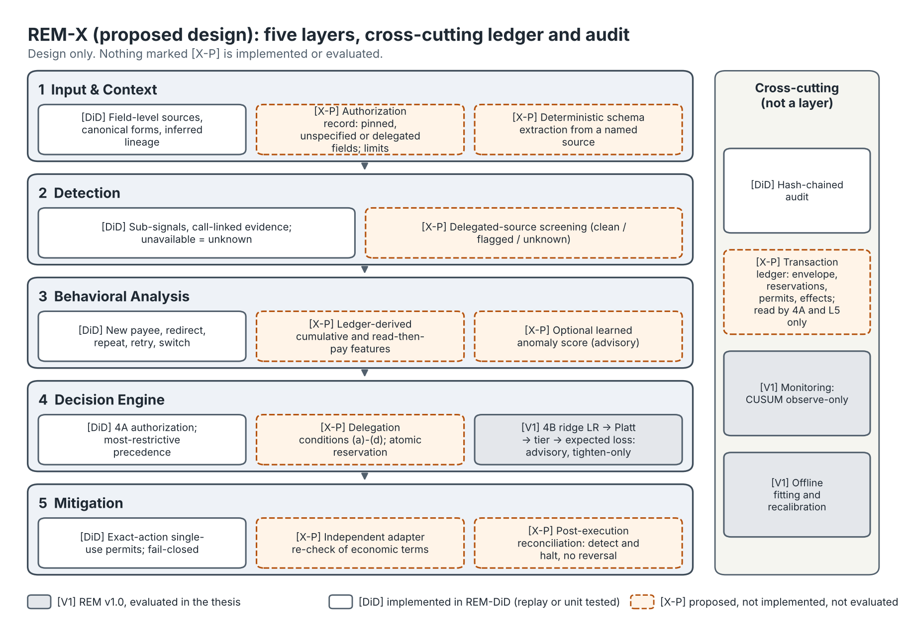

# Deliverable 5: Proposed architecture diagram

- **Figure:** `figures/fig_rem_x_proposed.png`
- **Generator:** `code/fig_rem_x.py` (matplotlib; run `python3 code/fig_rem_x.py` from this folder)

## How to read it

- **Exactly five layers**, top to bottom, as in the thesis.
- The right-hand band is **cross-cutting state and services, not a layer**:
  - audit;
  - the proposed transaction ledger;
  - CUSUM monitoring (observe-only, outside the verdict path);
  - offline fitting and recalibration.
- **The ledger is read only by 4A (reservation) and by L5 (permit, adapter re-check, reconciliation).** It is never read by L2.

**Fill and border show status:**

| Style | Status |
|---|---|
| Grey fill, solid border | [V1] REM v1.0 component, evaluated in the thesis |
| White fill, solid border | [DiD] implemented in REM-DiD; evaluated in exploratory NO-ADAPT replay with oracle authorization, or unit/scenario-tested |
| Orange fill, dashed border | [X-P] proposed for REM-X; **not implemented, not evaluated** |

**4B in the diagram.** 4B keeps the frozen REM v1.0 pipeline (ridge logistic regression → Platt calibration on the logit → consequence tier → expected-loss verdict). It is drawn as "tighten-only": under most-restrictive precedence its verdict can withhold a call but can never release one that 4A or L5 denies. Whether its *scope* should be narrowed to calls not fully pinned is a supervisor decision (file 06).

## What the diagram does not show

- **No arrow returns from L5 to L1.** There is no feedback-loop layer.
- **No operator/user node.** The trusted approval channel that writes the authorization record is an *assumption* (AS-3, `REM_DEFENSE_IN_DEPTH/25`), not an architecture node.
- **No reversal of executed transfers.** Reconciliation detects a deviation and halts the session.
